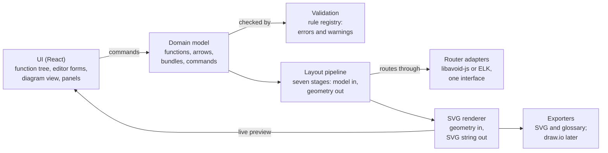

# IDEF0 Diagram Creator: Design Spec

Last updated: 2026-11-24 (pipeline stages revised during milestone 3)

## 1. Purpose and scope

The tool turns a model of functions and their inputs, controls, outputs and mechanisms (ICOMs) into rule-correct IDEF0 diagrams with no manual drawing. The user edits the model in a GUI, the diagram redraws beside it, and each diagram exports as SVG.

**Goals**

- Fast model entry through a GUI: add functions, start a decomposition, add ICOM arrows and connect them, with no JSON or syntax to write.
- Automatic layout good enough that the user never needs to rearrange: staircase boxes, orthogonal arrows, no arrow through a box, no label on a line.
- Navigation through decomposition levels, with parent arrows carried into each child diagram automatically and shown where they belong.
- Output matching the reference diagrams in the reference pack (A-0, A0, A2, A4): black and white, square corners, 8 px arc bends, NODE / TITLE / NUMBER footer.
- A codebase built for extension: new rules, layout strategies, export formats and notations plug in without edits to existing modules.

**Non-goals for version 1**

- Free-form placement of boxes and arrows.
- DFD support, draw.io or Visio export, and multi-user editing. The architecture leaves a seam for each (section 11).
- A backend or accounts. The model is a local JSON file.

## 2. Requirements

SVG export of each diagram is the only hard output requirement; everything else is ranked by how much it speeds up making a correct diagram.

| # | Question | Decision |
| --- | --- | --- |
| 1 | DFDs | Not in version 1. The model and layout stages stay notation-neutral where that costs nothing. |
| 2 | Model entry | GUI only: a tree of functions, a form per function, quick-add controls. JSON is the save format, never something the user types. |
| 3 | Child arrows absent from the parent | Boundary arrows come from the parent. A parent arrow may be split into named sub-arrows in the child. A tunneled arrow is allowed only when the user marks it explicitly. Anything else is an error. |
| 4 | Rule violations | Structural violations are errors that block export. Style and completeness issues are warnings. |
| 5 | Manual overrides | None in version 1. Layout quality is enforced by automated checks. Ordering hints are a possible later fallback. |
| 6 | Bundling | Explicit in the model as a bundle arrow with named members. Branching and joining are inferred from one arrow having several ends. |
| 7 | draw.io export | Not built. The exporter interface makes it a later plugin. |
| 8 | Platform | Browser app, run locally or from a static host, saving JSON files. |
| 9 | ICOM table and glossary | Glossary first: terms are filled in automatically from every function and arrow name, the user adds definitions, and it exports as Markdown. A per-function ICOM table uses the same exporter path. |
| 10 | UI framework | React. The UI is kept thin enough to port to Solid later. |
| 11 | Box count outside 3 to 6 | Allowed with a warning at every stage. |
| 12 | PNG export | SVG is enough. PNG is added only if rasterising the SVG in the browser turns out to be cheap. |

**Functional requirements**

1. Create, rename, reorder and delete functions; decompose any function into a child diagram of 3 to 6 functions.
2. Add arrows by role (input, control, output, mechanism) between functions or to the diagram boundary; one arrow may branch to several targets or join from several sources.
3. Opening a child diagram shows every parent arrow as a boundary arrow with its ICOM code (I1, C2, O1, M1), placed on the correct side, and lists any not yet connected inside the child.
4. Redraw the diagram after each model change.
5. Show rule violations in a panel, each linked to the offending element.
6. Export the current diagram or all diagrams as SVG; export the glossary.
7. Save and open a model file; undo and redo.

**Quality requirements**

- Layout: zero arrow-through-box and zero label-overlap cases on the four reference models; redraw under 500 ms for a 6-box diagram.
- Modifiability: a new rule, exporter or layout stage is one new file plus one registration line.
- Testability: domain, validation and layout run without a browser.

## 3. Technology stack

A TypeScript web app is the best fit because SVG is native to the browser, so the on-screen preview and the exported file are the same output.

| Concern | Choice | Reason |
| --- | --- | --- |
| Language | TypeScript, strict mode | Typed interfaces make the module contracts in section 4 checkable by the compiler |
| Build and dev server | Vite | Fast reload, simple static build |
| UI | React | It has the most mature component libraries and the best AI code-generation support, which matters most for a UI of forms and a tree. SolidJS 2.0 was considered and set aside as too new to rely on. The UI holds no rules or geometry, so a later port to Solid stays inside the `ui` module |
| Box placement | Custom staircase placer | IDEF0's staircase is a fixed convention that general graph layout engines do not produce |
| Arrow routing | libavoid-js (orthogonal, obstacle-avoiding) | Purpose-built for routing connectors around boxes with shared-path nudging |
| Alternate router | ELK.js behind the same interface | Fallback if libavoid results or its licence do not suit |
| Rendering | Custom SVG renderer, ported from the pack's `idef0.py` | Keeps the exact reference look; about 100 lines of drawing primitives |
| Tests | Vitest, plus SVG snapshot tests | Runs domain and layout tests in Node |
| Persistence | JSON file via the File System Access API, with download and upload as fallback | No backend |

Open point: libavoid-js is LGPL-2.1-or-later. It is used unmodified as an npm dependency, which is fine for a class project and for an open repository, but it should be confirmed before any other licence is chosen for this repo.

## 4. Architecture

Six modules pass data in one direction, and each depends only on the modules before it, so any one can be replaced without touching the others. The router adapters sit behind the layout module's `Router` interface.

The UI sends commands to the domain model and displays the renderer's SVG; nothing flows back from rendering into the model. Violations from validation are shown by the UI.

| Module | Depends on | Runs without a browser |
| --- | --- | --- |
| `domain` | Nothing | Yes |
| `validation` | `domain` | Yes |
| `layout` | `domain`, the `Router` interface | Yes |
| `render` | Layout geometry types | Yes |
| `export` | `domain`, `render` | Yes, except PNG |
| `ui` | All of the above, through the app shell | No |

The app shell is the only place that names concrete implementations: which router, which rules, which exporters.

## 5. Domain model

The model holds meaning only, with no coordinates, so the same model can be laid out, validated and exported by independent modules. It extends the shape of `change_control_model.json` in the reference pack.

| Entity | Key fields | Notes |
| --- | --- | --- |
| Model | name, purpose, viewpoint, context, root function, glossary | One file |
| Function | id, label, ordered children | The node number (A0, A2, A21) is derived from tree position, never stored |
| Arrow | id, label, list of sources, list of targets | An end is a function plus a role, or the diagram boundary. Several targets is a branch; several sources is a join |
| Bundle | arrow id, named member arrows | Explicit. Members may peel off to different functions |
| Boundary link | child arrow, parent arrow, kind | Kind is *inherited*, *split* (child arrow is a named sub-category of the parent arrow) or *tunneled* |
| Glossary entry | term, definition | Term is matched to function and arrow labels |

**Boundary inheritance.** A child diagram's boundary arrows are computed from the arrows touching its parent function, not stored twice. ICOM codes are derived from the order of arrows on the parent box side. When the user adds an arrow to a parent, it appears on the child's boundary as unconnected until attached to a child function.

**Splits.** The user picks a boundary arrow and splits it into labelled sub-arrows. On the diagram this draws as the parent arrow entering at the boundary and forking into its named branches.

**Tunnels.** Created only by an explicit "tunnel this arrow" action. They draw with parentheses at the arrow end and are exempt from the level consistency rule.

**Commands.** Every edit is a command object applied to an immutable model (add function, connect arrow, split arrow, and so on). This gives undo and redo, and gives the UI a single narrow way to change the model.

## 6. Validation

Each IDEF0 rule is one small object implementing `Rule { id, severity, check(model): Violation[] }`, registered in a list, so adding a rule never touches the others. Rule ids follow the rules spec in the reference pack.

| Severity | Rules | Effect |
| --- | --- | --- |
| Error | M2 one box on A-0 · M5 level consistency (every parent arrow connected in the child, unless split or tunneled; no child boundary arrow without a parent link) · B3 role matches side · B4 at least one control and one output per function | Blocks export of the affected diagram |
| Warning | M3 3 to 6 boxes per child diagram · B7 duplicate label on a diagram · B1 function label is not a verb phrase · arrow or function missing from the glossary · empty label | Shown in the panel; export allowed |

The 3 to 6 rule is a warning. The staircase placer and router take any number of boxes, so the count does not limit the program; a diagram outside the range still draws and exports, with the warning shown. Layout tests cover 1 to 8 boxes. Severity is a field on the rule, so the split above can be changed in one place.

Some errors are prevented by construction instead of detected: the GUI only offers the four roles, so a diagonal arrow or an input on the top side cannot be expressed.

## 7. Layout pipeline

Layout is a chain of stages, each a pure function from one layout state to the next, so any stage can be replaced or tested alone. This is the hard part of the tool and the part Holarch got wrong, so it gets the most structure.

| # | Stage | Does | Convention it implements |
| --- | --- | --- | --- |
| 1 | Build view | Selects one diagram's functions and arrows from the model and computes its boundary arrows, ICOM codes and the order of arrows on each box side | M5, M6 |
| 2 | Place boxes | Staircase from top-left to bottom-right; box size grows with label length and the number of arrows on its busiest side | D1 |
| 3 | Assign side slots | Fixes the point where each arrow meets each box side, in the side order from the view | Slot spacing 20 to 25 px |
| 4 | Plan connections | Turns each arrow into point-to-point connections for the router. A boundary arrow that serves several boxes becomes a rake: straight to its first box, with a lane beside the frame edge carrying the branches | B8 |
| 5 | Route | Orthogonal routing around boxes through the `Router` interface | B6, D3 |
| 6 | Merge buses | Draws the path that connections of one arrow share only once, so branches start at T-junctions and joins end on their trunk | B8 |
| 7 | Place note | Puts the diagram note in the largest free corner, before labels so that labels keep clear of it | |
| 8 | Place labels | Tries a ranked list of spots beside each arrow's own segments and takes the first that touches no box, line or other label; falls back to a leader squiggle | B10 |
| 9 | Check | Records arrow-through-box, a label on an arrow, box or other label, and out-of-frame geometry as defects on the geometry | Quality gate |

**Side order.** The order of arrows along a box side is a rule over the model, not a layout result: outputs that reach farthest come first, inputs from earlier boxes sit above boundary inputs, feedback comes last. It lives in the domain (`arrowsAt`) because ICOM codes on the child diagram follow the same order, and the two must never disagree.

**Rakes.** Because of the staircase, a lane next to a frame edge and the straight branches from it can never meet a box, so rakes are planned without search and handed to the router as fixed corners. The router still sees them, which lets it keep other arrows off the same line.

**Interfaces.** Every stage implements `LayoutStage { name, run(state): LayoutState }`. The router sits behind its own `Router` interface with a libavoid implementation and an ELK implementation, chosen in one configuration object.

**Quality gate.** The gate is a decorator around the pipeline, so the stages know nothing about retries. If the check stage finds a defect, or a label needed a leader line, the gate runs the pipeline again with wider gaps and a larger canvas, up to a fixed number of attempts, and keeps the attempt with the lowest penalty (a defect weighs far more than a leader). A defect that survives stays on the geometry as a layout warning, so a bad drawing is never exported silently. This loop is what replaces manual rearranging.

**Output.** The final state is a plain geometry description (rectangles, polylines, text anchors) with no SVG in it, which is what keeps renderers and exporters independent of layout.

**Stability.** Stages are deterministic, and box order follows the model's order, so a small model edit produces a small visual change.

## 8. Rendering and export

One renderer turns layout geometry into an SVG string, and both the on-screen preview and the SVG export use that same string, so what the user sees is what they export.

- **Renderer.** A port of `idef0.py`: square boxes at stroke 1.6, arrows at stroke 1.3 with radius 8 arc bends, arrowheads as separate filled triangles, frame and NODE / TITLE / NUMBER footer. Style values live in one `Theme` object taken from part 2 of the rules spec.
- **Exporters.** Each implements `Exporter { id, label, fileExtension, export(model, selection): Blob }` and registers itself. The export menu is built from the registry.

| Exporter | Version 1 | Input |
| --- | --- | --- |
| SVG, one diagram or all | Yes | Layout geometry through the renderer |
| Glossary as Markdown | Yes | Model only |
| ICOM table per function, Markdown or CSV | If time allows | Model only |
| PNG | If it comes cheap | Rasterised from the SVG in the browser |
| draw.io | No | Layout geometry; `a0_drawio.py` in the pack shows the mapping |

**Glossary.** The glossary panel lists every function and arrow label in the model. The user types definitions; terms that leave the model are flagged as unused, not deleted, so a rename does not lose a definition.

## 9. GUI

The screen has three panes: a function tree on the left, the live diagram in the centre, and an editor for the selected function or arrow on the right, with the violations and glossary panels in a drawer below.

- **Function tree.** Shows the decomposition with node numbers. Clicking a node opens its diagram. "Add function" and "Decompose" act on the selection.
- **Diagram.** Read-only drawing with pan and zoom. Clicking a box or arrow selects it in the editor; double-clicking a box opens its child diagram; a breadcrumb (A-0 › A0 › A2) goes back up.
- **Editor.** For a function: its label, and four lists (inputs, controls, outputs, mechanisms) each with an add row. Adding an arrow asks for a label and the other end, chosen from a dropdown of the diagram's functions plus "boundary". Typing an existing arrow's label offers to branch that arrow instead of creating a duplicate.
- **Inherited arrows.** On a child diagram the editor lists each parent arrow with its ICOM code and state: connected, split, or unconnected. Unconnected ones show on the diagram at the correct frame edge, drawn dashed, until attached.
- **Speed.** Every add action has a keyboard shortcut and keeps focus in the add row, so several arrows can be entered in a row without the mouse.

The UI talks to the rest of the app only by dispatching commands and reading the current model, layout result and violations. It contains no IDEF0 rules and no geometry.

## 10. Design principles applied

Each principle below is tied to a specific decision in this design, so it can be checked in code review.

| Principle | Where it shows up |
| --- | --- |
| Separation of concerns | Model, validation, layout, rendering, export and UI are separate modules; the model has no coordinates and the layout has no SVG |
| Single responsibility | One rule per rule object, one job per layout stage, one format per exporter |
| Open/closed | New rules, stages, routers and exporters are added by registration, with no edits to existing modules |
| Dependency inversion | The pipeline depends on the `Router` and `LayoutStage` interfaces, not on libavoid or ELK; the app shell wires in the concrete choices |
| Interface segregation | Exporters that need only the model (glossary) are not forced to depend on layout |
| Liskov substitution | Any `Router` must pass the same contract test suite, so the two implementations are interchangeable |
| Information hiding | Third-party libraries are wrapped in adapters; no libavoid type appears outside its adapter file |
| Low coupling, high cohesion | Dependencies point one way, from UI inward to the domain; enforced with an import-boundary lint rule |
| Single source of truth | Node numbers, ICOM codes and child boundary arrows are derived from the model, never stored twice |
| Make illegal states unrepresentable | Roles are a closed type; a boundary link must name its kind, so an unexplained child arrow cannot exist silently |

**Patterns used:** Pipes and Filters (layout), Strategy (router, box placer), Command (edits, undo and redo), Adapter (libavoid, ELK, file access), Registry (rules, exporters), Observer (UI subscribing to the model store).

## 11. Extension points, testing and plan

**Extension points**

| To add | Implement | Touches existing code |
| --- | --- | --- |
| A new rule | `Rule` | One registration line |
| An export format (draw.io, PDF) | `Exporter` | One registration line |
| A different router | `Router` | One configuration value |
| Manual ordering hints | A new stage before "assign side slots", plus an optional hints field on the model | Pipeline list |
| DFD notation | A new view builder, box placer, rule set and theme; router, label placer, checker and exporters are reused | App shell only |

**Testing**

- Domain and validation: unit tests on commands and on each rule.
- Layout: the reference model (`change_control_model.json`) is the fixture. Tests assert the quality gate reports zero defects on A-0, A0, A2 and A4, and compare SVG snapshots.
- Router contract tests run against both implementations.
- Visual check against the reference PNGs when a stage changes.

**Milestones**

1. Domain model, commands, JSON load and save, with the reference model loading cleanly.
2. Renderer port and a pipeline with box placement and naive routing; A-0 draws correctly.
3. libavoid routing, side slots and bus merging; A0 draws without defects.
4. Label placement and the quality gate; all four reference diagrams pass.
5. GUI: tree, editor, navigation, inherited arrows, violations panel.
6. SVG export of all diagrams, glossary panel and export.

**Risks**

- Layout quality is the main risk. Milestones 2 to 4 come before the GUI so it is retired first, using the pack's JSON as input.
- Bus merging and label placement have no library; both are custom and need the most test cases.
- libavoid-js is a WebAssembly build with a thin API surface; ELK is the planned fallback.
